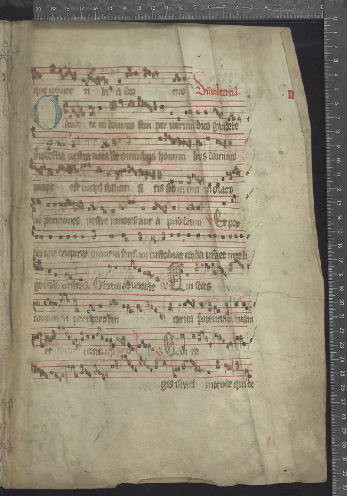

# The Lost Library

**Can AI help reunite the surviving pages of a lost medieval book?**

The Lost Library is an independent, AI-assisted research project exploring medieval music manuscripts that were dismantled and reused as archival bindings. It combines a visual fragment atlas, a retrieval experiment, and source-linked research into the difficult question of which surviving leaves once belonged together.

> **Result:** This project did not establish a new manuscript attribution or recover an unknown book. It produced an exploratory research tool, a documented reconstruction of an already known book, a small evaluation, and a reproducible data-quality observation. The historical leads remain open to further evidence and specialist review.



*Riksarkivet Fr 7957, a surviving fragment of the previously documented Graduale Aboense. Image: Swedish National Archives; see the [source record and rights](data/fragments.json).*

## The mission

This was a deliberately ambitious AI research project: use computation to uncover a connection in historical material that a human could then inspect, challenge and verify.

The focus was a library dispersed into fragments. The stretch goal was a defensible new connection between pages of a medieval manuscript. We did not reach that goal. We retain the evidence, controls and negative results so that the work can be inspected and extended without turning a plausible match into a false discovery.

## Explore the project

- **[Open the local atlas](viewer/)** after starting the server below. Browse 120 imaged physical objects, compare photographs, inspect source records, and follow the evidence behind ten fixed comparisons.
- **[Read the research paper](RESEARCH_PAPER.md)** for the question, results and limitations.
- **[Inspect the evidence dossiers](EVIDENCE_DOSSIERS.md)** for observations, contrary evidence and unresolved alternatives.
- **[See the final research checkpoint](LAST_SHOT_CHECKPOINT.md)** for the last discovery attempt and the precise evidence it still needs.
- **[Review the validation](VALIDATION_REPORT.md)** for the benchmark, controls and reproducible results.

## What the investigation found

The ten-case screen contains two previously documented associations, one previously published rejection and seven unresolved comparisons. These are source screens, not independent expert verdicts.

The metadata baseline ranked well in a small, selected test gallery: mean reciprocal rank 1.00 across 24 queries from four reference groups. But at its chosen threshold it also accepted **40 of 72** catalogue-labelled different-group pairs, and every tested method accepted a published different-book example. These numbers describe this exploratory benchmark, not an accuracy estimate or probability of identity for an unknown fragment.

A separate audit found that 5,598 of 14,415 eligible exact links disagreed between the combined BOMPAC dataset's column field and the original catalogue field. This is a reproducible discrepancy, not 5,598 individually verified corrections. Its cause, wider impact and novelty remain unverified. See the [paper](RESEARCH_PAPER.md) and [audit](RESEARCH_CONTINUATION_108.md).

## Run locally

Tested with Python 3.12 on macOS arm64. Dependency installation requires internet access; the supplied cached features and data support the offline replay.

```sh
python3.12 -m venv .venv
.venv/bin/python -m pip install -r requirements.txt
.venv/bin/python -m lost_library serve --port 8765
```

Open **http://127.0.0.1:8765/viewer/**. The server listens on your computer only; stop it with Ctrl+C. On Windows, use `.venv\Scripts\python.exe` in place of `.venv/bin/python`.

To reproduce the cached pipeline and run the checks:

```sh
.venv/bin/python -m lost_library run --offline
.venv/bin/python -m unittest discover -s tests -v
node --test tests/viewer.test.cjs
```

The viewer is buildless HTML, CSS and JavaScript. Node is needed for the viewer's automated checks, not for browsing it. Recomputing visual features from scratch requires the official ResNet-18 weights; the cached replay does not. Details and individual commands are in the [research guide](RESEARCH_GUIDE.md) and [research history](RESEARCH_HISTORY.md).

## Sources, rights and limits

The work builds on collections and prior scholarship, particularly the Swedish National Archives' [MPO metadata](https://zenodo.org/records/17287665), the National Library of Finland's [Fragmenta membranea](https://fragmenta.kansalliskirjasto.fi/), the [BOMPAC dataset](https://doi.org/10.5281/zenodo.17511106), and existing [CODICUM research](https://www.codicum.eu/). Existing associations are credited as such. AI assisted source discovery, image reading, analysis and drafting; its readings are not independent expert review.

Source images and data carry their own rights and attribution requirements. The release excludes private scholarly reading copies and model weights. See [DATA_RIGHTS.md](DATA_RIGHTS.md) and [THIRD_PARTY.md](THIRD_PARTY.md). No code licence has been selected; third-party material is governed separately by its stated terms.
