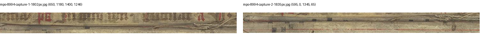

# E35: Controlled Fr 8994 photograph-overlap test

27 October 2026. A new fixed numerical test follows E34's incomplete surface mapping. The interrupted preceding goal turn re-read state and images but added no result, so it is classified as **no progress**, not a verified wait or an access blocker. E35 now changes the evidence record. The existing amended goal remains active.

## Question and method

Can repeated photographed detail link the proposed capture 1/2 and 3/4 boundaries? The [protocol](research/continuation_35/protocol.json) was saved before execution. Earlier inspection of all four photographs is disclosed; this is exploratory. Six fixed ROI comparisons comprise two candidates, Fr 20274's previously observed overlap, one same-photograph resolution control, and two non-repeated-detail controls. These are image-registration controls, not new codex labels.

The test reuses E20's retained isolated OpenCV 4.13.0 runtime: fixed CLAHE, SIFT, mutual ratio <0.75, homography RANSAC at 3px, at least eight matches/inliers/distinct positions and at least 20% span of both ROI axes on both images. No parameters or crops were changed after the result. Deduplicating inlier locations prevents repeated SIFT orientations from inflating distinct physical points. Every mutual correspondence is retained, including outliers, with global source coordinates, hashes, dimensions and provenance.

## Results

| Comparison | Mutual matches | Inliers | Distinct positions, left/right | Fixed screen |
|---|---:|---:|---:|---|
| Fr 8994 1/2 | 25 | 10 | 10 / 10 | Failed: vertical distribution |
| Fr 8994 3/4 | 25 | 6 | 4 / 4 | Failed |
| Fr 20274 known photographed overlap | 2,158 | 1,979 | 1,725 / 1,724 | Passed |
| Fr 8994 same photograph at two resolutions | 1,416 | 1,406 | 1,203 / 1,200 | Passed |
| Fr 8994 1/3 non-repeated-detail control | 141 | 7 | 4 / 4 | Failed |
| Fr 8994 / Fr 20274 non-repeated-detail control | 5 | 5 | 4 / 4 | Failed |

The 1/2 fit is worth retaining: its ten distinct inliers span about 48% of width but only 13%/16% of ROI height, approximately 29–31 vertical pixels. Median inlier error is about 0.367px. Post-fit inspection of the original-pixel strips finds a candidate shared folded edge with black ink/rule detail. It does **not** pass the declared distribution gate; the gate was not relaxed. This is an unresolved thin-strip clue, not an accepted stitch or complete surface map. The 3/4 and non-repeat fits do not supply an accepted overlap.



Both positive controls passing shows that this implementation can recover these particular retained overlaps. It does not establish sensitivity to a damaged, folded or almost non-overlapping boundary, and the same-photograph control is especially easy. Failure cannot establish different surfaces. RANSAC's small residual with only four distinct points in some controls is not evidence of a true correspondence.

## Scientific effect and reproduction

E33's conditional Finnish-address conflict remains unresolved. No medieval recto/verso map, physical seam, new same-book exclusion, improved matching model or novelty clearance results. No source image, frozen review, ranking, feature or evaluation file changed. There were no new downloads or physical objects.

The complete [numerical result](research/continuation_35/feature_results.json), [scoped interpretation](research/continuation_35/results.json), six all-match figures and exact ROI protocol are retained. The ontology now uses `photographic_overlap` for this imaging question, distinct from `physical_join`, `textual_continuation` and `same_codex`.

```sh
PYTHONPATH=/private/tmp/lost-library-cv20/isolated .venv/bin/python research/continuation_35/check_overlap.py
```

That command uses the already retained optional runtime recorded in E20's dependency receipt; an extracted review package does not bundle it. To reproduce elsewhere, use the exact recorded OpenCV package in an isolated environment. Integrity/knowledge checks and E36 need only the project's ordinary dependencies. Generated figures are labelled analysis derivatives of existing PDM sources, not extra source photographs.

The next external test remains Finnish f.8/ff.9–10 and Fr 20278 through a genuinely new ordinary lawful route. Repeating challenged routes or tuning a failed overlap into acceptance is not justified. Locally available primary comparisons remain open.
