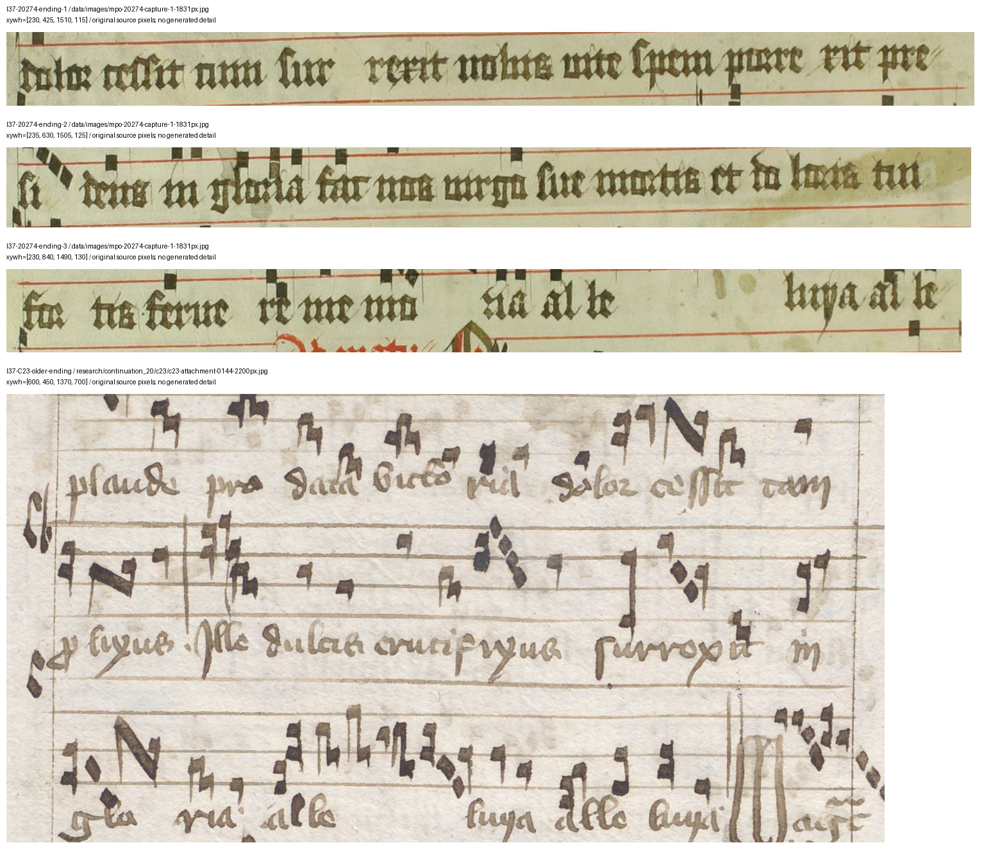

# E37: Fr 20274's surviving antiphon ending and a completed prior-source check

27 October 2026, Europe/Vienna. The preceding E35/E36 turn was progress. This continuation adds a source-visible identification within the existing Fr 20274 case, reads relevant earlier scholarship and documents a precise C435 image dependency. The original discovery goal remains active.

## What changed

The three rows above Fr 20274's matins invitatory provisionally preserve the shorter **O Maria stans sub cruce** ending. The key evidence is the extended *nobis vite spem porrexit / presidens in gloria* phrase followed by the *Fac nos Virgo* petition. The older **O Maria dolorosa** ending on the retained actual C23 71v page has different words: *tam prolixus / ille dulcis crucifixus*. Shared words such as *dolor*, *surrexit* and *gloria* alone would not distinguish them.

This identifies a **selected surviving ending**. The fragment does not retain the incipit, and this result does not assign its whole office to one recension, date it, locate its production or identify its parent codex. Mixed textual states remain possible. This is a new local observation in our record; **first notice and scholarly novelty are not established**.

The target's secondary readings *cum* and *feruere* are provisional. Hallqvist's apparatus reports them for multiple witnesses, including C21/C23, rather than uniquely for one branch. C435 original-image verification remains missing. No melodic identity, common exemplar, copying direction or direct dependence on C23 is inferred.



## Prior scholarship and access

[Hallqvist 2020](https://lup.lub.lu.se/student-papers/record/9032430/file/9032431.pdf), printed p.4/PDF51 and p.19/PDF66, already distinguishes these texts. The complete relevant pages and apparatus were visually checked. Her introduction p.x/PDF15 says that C435 was not digitized in 2020 and that she held commissioned photographs. That dated statement is more specific than assuming an expert has unspecified hidden information. An ordinary current Alvin search for the exact shelfmark reached an Anubis verification page; it was stopped and the tab closed. Current digitization status is unresolved, not universally unavailable. No request was sent.

[Urberg 2016](https://doi.org/10.6082/uchicago.1751) was legitimately acquired from its open University of Chicago record and verified against the published MD5. Printed pp.247–267/PDF273–293 were read, with adjacent context; pp.254–257 and the musical figures were visually checked. Her analysis of C23's textual/musical redactions and replacement antiphons is established prior work. It supplies comparison criteria, not a new historical theory from this project. The 996-page PDF was text-searched, not read completely. None of four searched target numbers occurred in extracted text; that search does not clear novelty or rule out other identifiers, images, scholarship or unpublished evidence.

The private 425,202,182-byte PDF and copyrighted page renders/full extracted text are excluded from the review archive. The archive includes only metadata, short attributed paraphrases, input receipts and the PDM manuscript-region figure above. The initial binary-MIME rejection was our download check's error, not an institutional access denial; the successful transfer is counted once. The resource plan is now **1,640,851,781 bytes** against 3 GB, retaining the earlier 1 GB reserve. Working manuscript source files remain **177** against 300.

## Method and coverage

The initial [protocol](research/continuation_37/protocol.json) required mapping published diagnostics to actual target coverage. The [specific ending recheck](research/continuation_37/magnificat-test.json) discloses that the first target reading was unrecognized and the identification was literature-assisted. It is exploratory, not blind or preregistered confirmation. Four [annotations](research/continuation_37/observations.json) retain literal source forms separately from normalization, exact pixels, hashes and original URLs.

| Diagnostic | Target coverage and result |
|---|---|
| First-vespers Magnificat ending | Present: the shorter ending is provisionally supported against the directly inspected older C23 ending. |
| Responsory text redactions | Required passages are not visible in retained target images; no test result. |
| Responsory melody redactions | Required passages are not visible; no pitches compared. |
| Benedictus-antiphon replacement | Required passage not visible; no test result. |
| Second-vespers Magnificat replacement | Required passage not visible; no test result. |
| Matins hymn | E20's lack of a written hymn entry remains a difference of written scope, not proof about performance. |

The retained older C23 71v image is **not** the added/replacement text on C23 69r. Treating it as that comparator would create a false comparison. The next local-source objective is an explicitly identified lawful 69r view, followed by independent reading of the target and comparator notation before any melodic assertion. C435 originals could verify the reported lexical differences. The Finnish paired-signature/full-text comparison remains the principal attribution test outside this textual subcase.

## Representation, reproduction and limits

The ontology version 1.2.0 adds a small `Chant` entity type so a text identification cannot silently become a physical book assignment. It contains **165 overlapping entries, 117 pair leads, 860 entities, 576 claims and 81 regions**. Ninety-three pairs still have only catalogue/availability triage. The E37 ending claim is supported within its scope; the C435 original-image check is not testable with current local material. No global blocker follows.

```sh
.venv/bin/python research/continuation_37/record_evidence.py
.venv/bin/python research/continuation_37/check_sources.py --require-private
.venv/bin/python -m lost_library knowledge build
.venv/bin/python -m lost_library knowledge validate
.venv/bin/python -m lost_library knowledge export
```

The strict source check verifies the two locally retained scholarly PDFs. In an extracted review package, omit `--require-private`: it verifies the four retained manuscript regions and metadata while explicitly reporting the excluded reading copies as missing. Hash/coordinate/string checks do not independently verify paleography. The five frozen files, core records and model/evaluation remain unchanged. None of the seven ambiguous frozen cases is resolved, and no claim meets the project's novelty standard. No outreach, upload or publication occurred.
