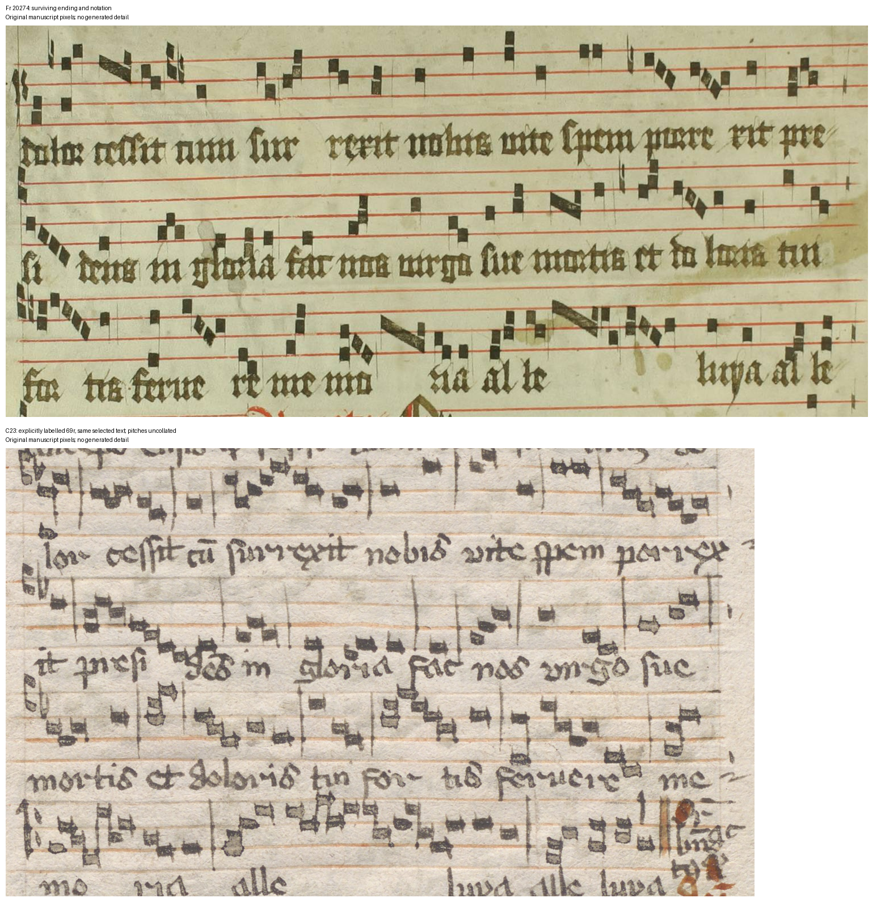

# E38: the actual C23 replacement page

27 October 2026, Europe/Vienna. E37 was progress: relevant scholarship was read, a previously unrecognized target passage identified and exact image regions retained. This follow-up resolves one of E37's specific source dependencies. The discovery goal remains active.

## Result

The public [C23 record](https://www.alvin-portal.org/alvin/view.jsf?pid=alvin-record:160517) opened normally. Its page viewer explicitly labels **Folio 69r**, and the selected thumbnail exposes [this original TIFF](https://www.alvin-portal.org/alvin/attachment/download/alvin-record:160517/ATTACHMENT-0139.tiff). The folio identification follows those labels, not attachment arithmetic. The institutional record states Public Domain Mark 1.0; complete browser text receipts are retained.

The actual page contains **O Maria stans sub cruce**, including the shorter *nobis vite spem porrexit / presidens in gloria / Fac nos Virgo* ending. Its *cum* and *feruere* readings agree with the provisional Fr 20274 readings. This directly supports the selected-text identification against the different older C23 71v ending. The comparator's visible incipit does not supply a literal reading of the fragment's missing incipit.

This is evidence for a shared version of a passage, not a newly identified parent book, date, place, common exemplar or direction of copying. The version and C23 replacement history were already published; [E37](RESEARCH_CONTINUATION_37.md) credits that scholarship. No distinctive shared error or unique transmission branch is established. Whole-office recension and first notice of this fragment passage remain unestablished. None of the seven frozen ambiguous attribution cases is resolved.



## Scope and next test

The [protocol](research/continuation_38/protocol.json) was recorded before inspecting this page. The target, older C23 page and published explanations were already known, so this is exploratory, literature-assisted work. The entire page was visually inspected for context; three retained regions document the selected incipit and ending. The lexical comparison does not amount to a complete diplomatic edition of the page.

Both witnesses retain notation over the selected passage. Their line breaks and layout differ. A verified clef and note-by-note transcription is **not completed**; no melodic identity or musical genealogy is claimed. The next local test is a bounded, explicitly aligned reading of that notation, retaining ambiguous notes and testing disagreements. Shared standard music would still not establish codex identity.

The missing C23 69r dependency is marked resolved in the current knowledge overlay, with its historical record preserved. The older 71v image remains a distinct comparator. C435 originals are still uninspected, and its challenged search is not revisited. The Finnish signature/full-text attribution test and other unresolved leads can continue independently. No global blocker or exhausted-negative conclusion follows.

## Resources and reproduction

One exact original was downloaded: **24,826,245 bytes**, SHA-256 `499bb35b4b6864b3caa87b547d2a6b757ac133f5586ab472e12152dea9daa9e7`. Its 2200-pixel JPEG derivative is declared; neither image has generated or restored detail. These two files bring the working manuscript inventory to **179** against 300. The conservative transfer plan is **1,665,678,026 bytes**, including the existing 1 GB reserve, against 3 GB. C23 remains one comparison witness, not an additional independent historical source merely because another page was acquired.

The knowledge overlay version 1.3.0 has **166 overlapping entries, 117 pair leads, 864 entities, 578 claims and 84 regions**. Ninety-three pairs still have catalogue/availability triage only. All five frozen files and the core fragment/metadata files remain unchanged.

```sh
.venv/bin/python research/continuation_38/record_evidence.py
.venv/bin/python research/continuation_38/check_sources.py
.venv/bin/python -m lost_library knowledge build
.venv/bin/python -m lost_library knowledge validate
.venv/bin/python -m lost_library knowledge export
```

The scripts check original/derivative hashes, dimensions, bounds, retained labels and declared scope. They do not independently validate paleography or originality. The source-linked records and PDM comparison figure are included in the local review package; private scholarly reading PDFs and their renders remain excluded. No outreach, upload, external catalogue change or publication occurred.
