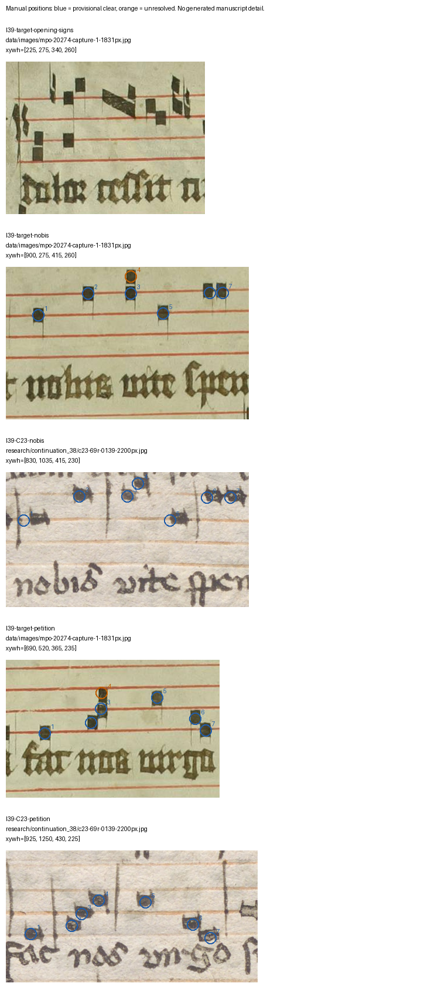

# E39: a bounded musical comparison, with uncertainty retained

27 October 2026, Europe/Vienna. The previous E37/E38 continuation was progress: it read relevant scholarship, identified a selected target ending, acquired the actual C23 replacement page and verified the offline package. This continuation adds a partial musical reading and further prior-art evidence. The scientific goal remains active.

## What the sources support

Two internal windows, **Nobis vite spem** and **Fac nos Virgo**, yield twelve provisional concordances in relative diatonic staff position. Two additional upper events in the target remain unresolved. This is **partial compatibility**, not exact excerpt identity, verified absolute pitches, a complete melody or a new manuscript relationship.

The seven proposed alignment slots in each window are retained in full, including the uncertain ones. Each window starts at relative staff-step zero separately, so this representation loses absolute register. The numbers are staff steps, not semitones, rhythms, identity probabilities or retrieval accuracy. No accepted contour match is obtained by choosing whichever alternative agrees with the reference.

| Window | Proposed positions | Provisional concordances | Unresolved |
|---|---:|---:|---:|
| Nobis vite spem | 7 | 6 | Upper event over *vi* |
| Fac nos Virgo | 7 | 6 | Upper event over *nos* |

The planned *Dolor cessit* opening was attempted, but several signs near target x245/x305/x520 were not securely classified. A complete opening transcription and absolute pitches are therefore withheld. The internal-window selection is a disclosed post-inspection change, not a blind confirmation. This is work by one AI reader with prior source/edition exposure.



## What earlier work already contains

Urberg’s 2016 dissertation, **Appendix F printed pp.600–605 / PDF626–631**, already gives a synoptic comparison of this shorter antiphon in six labelled witnesses: C23, C21, Tammela, Gummerus, MPO Fr10311 and MPO Fr23744–23745. Those complete score pages were visually inspected. Broad internal contours are shared; there are also variants, including a different note count over *spem* in the last MPO witness. This is a report of the published score, not inspection of six original manuscripts or six independent confirmations.

The previously checked Example4.4 on printed p.257/PDF283 shows the opening, not these two ending windows. It cannot verify the selected windows by itself. The new Appendix F check is consequently a real extension of the prior-art reading. It makes a common-melody agreement less useful as a distinctive attribution clue. It does not establish first notice of Fr20274’s reading, resolve its parent book or prove scholarly novelty.

Official [Cantus Volpiano protocols](https://cantusdatabase.org/static/documents/2.%20Volpiano%20Protocols.pdf), dated 8 August 2016 in the document, supplied basic rules for pitch and text alignment, separating guide signs from sounding notes, and retaining uncertain signs. Printed pp.2,3,5,6 were read and visually checked; the entire seventeen-page guide was not read. No Cantus submission or approved Volpiano transcription is claimed.

## Reading history and exact review points

The [initial protocol](research/continuation_39/protocol.json) and [v1 reading](research/continuation_39/readings.v1.json) remain unchanged. Both images had been viewed together while locating the text, so serialization into separate source records does not make the reading blind or independent.

In v2, the C23 *vi* upper event was clarified with Urberg’s published score after retaining the uncertain first reading. That is editorial assistance. It does not independently confirm the target. The two target upper events remain unresolved between nominal staff positions. Centre arithmetic alone cannot distinguish a real pitch variant from how a vertical ligature was drawn.

Inspection of the first diagnostic figure also found several petition circles beside their intended noteheads. [V3](research/continuation_39/readings.v3.json) corrects those source anchors, preserving the preceding versions and an explicit correction note. The staff-step alternatives and comparison counts did not change. The final figure was re-inspected against its source pixels.

The three exact remaining issues are the opening signs, target *vi* upper event (1113,291), and target *nos* upper event (853,576). They are local reading questions. No expert contact or new acquisition is required merely to retain and investigate them. A source-grounded resolution may change this bounded comparison; even a common exact melody would not by itself identify a codex.

## Reproduction and current state

```sh
.venv/bin/python research/continuation_39/compare_notes.py
.venv/bin/python research/continuation_39/record_evidence.py
.venv/bin/python research/continuation_39/check_sources.py --require-private
.venv/bin/python -m lost_library knowledge build
.venv/bin/python -m lost_library knowledge validate
.venv/bin/python -m lost_library knowledge export
```

The [CSV](research/continuation_39/note_positions.csv) and [comparison JSON](research/continuation_39/comparison.json) expose all fourteen slots and their alternatives. The checker verifies source hashes, coordinates and arithmetic, not musical truth. In the extracted review package omit `--require-private`: private PDF reading copies are deliberately absent, and the checker reports that explicitly.

Five new manuscript regions bring the version1.4.0 overlay to **167 overlapping entries, 117 pair leads, 865 entities, 579 claims and 89 regions**. Ninety-three pairs still have only catalogue/availability triage. Core records, five frozen experiment files, models and thresholds remain unchanged. No new manuscript image was downloaded; the working inventory remains **179**. One official method PDF added **1,083,153 bytes**, bringing the conservative transfer plan to **1,666,761,179 bytes** including the existing 1GB reserve. This method acquisition extends the protocol’s local-source plan within the existing resource authorization. Private method/dissertation PDFs and their page renders are excluded from the review archive; its new figure contains only PDM manuscript pixels and project markings.

The useful next attribution work remains the Finnish paired-signature/full-text test and other discriminating primary-source leads. Repeatedly scoring this shared musical material would not clear novelty. No new codex attribution, independent confirmation, public publication or exhausted-negative outcome is claimed. No outreach occurred.
