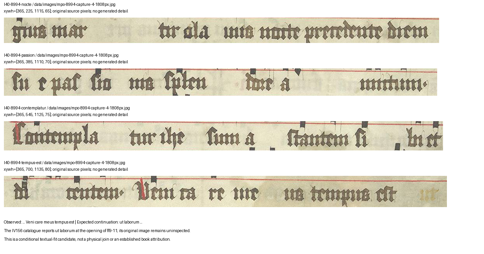

# E40: an exact word-boundary test for Fr8994

**E97 qualification:** Pale marks are visible to the right of *tempus est*. Their status and reading are unresolved; treat that phrase as the last **clearly transcribed** words, not a demonstrated blank continuation or physical end. [E97](RESEARCH_CONTINUATION_97.md).

**4 November access-planning qualification:** The [indexed National Library IV.156 description](https://fragmenta.kansalliskirjasto.fi/handle/10024/1299) includes folio 9 among leaves described collectively as dark, faded or otherwise partly or entirely damaged. It does not specify which condition applies to the relevant side or the extent of damage at *ut laborum*. The catalogue's opening belongs to its grouped description of ff. 9–11; locating it on an actual capture and reading its signature remain necessary. A future image request should include both sides and sufficient detail to assess legibility, rather than presuming that the needed text is readable. This is a catalogue assertion, not inspection of the Finnish leaf or evidence against a match.

27 October 2026, Europe/Vienna. The previous E39 turn was progress: a bounded musical reading, further prior-art inspection and an independently replayable package were recorded. E40 returns to the principal Finnish attribution question. It adds a precise source observation and conditional placement test, not a newly identified codex.

## New source observation

The last visible text row of Fr8994 capture4 reads **dicentem. Veni care meus tempus est**. The preceding rows identify the *Egregius martyr Olavus* responsory and include *sue passionis*. Five exact regions retain those readings and an upper-span control: capture1 contains the preceding *Exultabat* verse. The observed span therefore includes material before the third-nocturn rubric as well as the later third-nocturn chants.

The [official IV.156 catalogue](https://fragmenta.kansalliskirjasto.fi/handle/10024/1299), available here as indexed text, reports **ut laborum** at the opening of ff.9–11 in that responsory. Those are the expected next words after the Swedish terminal phrase. This is a substantially more precise comparison than sharing a feast or incipit, but common chant wording still recurs across different books.



## What this changes—and what it does not

The next source test now has an exact target: the original opening of IV.156 f.9, compared with the terminal Swedish row. Inspect the words, notation, signature and physical edge together. The Codex1505/IV.156 association is already suggested in the catalogue and represented in BOMPAC-5324. Whether this particular placement was previously noticed remains uncleared; the exact Taitto discussion and relevant Keskiaho chapter are still unread.

The current result has two states: the Swedish reading is locally supported, while the proposed continuation/placement is **unresolved**. The Finnish scan was not inspected. Capture4 is not independently mapped to a complete medieval surface, and folds or hidden text may affect the apparent endpoint. No physical seam, immediate adjacency or complete numbering succession is established. In particular, the leading numeral in the indexed Finnish signature is unclear; it is **not silently normalized to V** to manufacture an IV–V sequence.

A further conditional prediction can be recorded before the Finnish scan is read: if the proposed one-leaf/surface map and uninterrupted opening-signature series are correct, the following recto should carry **V**. This is a predicted observation, not a reading of the unclear catalogue numeral. Its premises and unverified state are preserved in the results.

The alternative IV.157 comparisons remain separate. E33’s folio8 address conflict keeps its original conditions. The catalogue’s ff.9–10 range contains overlapping *Egregius* material, which is a different comparison from the proposed terminal-to-opening fit. Neither catalogue statement substitutes for a paired image examination. Fr20278 remains a particular missing comparator; no usable image pointer was found in its pinned record or the bounded searches, and universal present availability is not inferred.

## Concordance and access record

The publisher’s existing St Olaf text and Steffen Hope’s 2018 thesis give the expected phrase continuation. Hope’s MR8 discussion and Appendix III also supply known office context. These are concordances, not transcriptions of either target fragment. Readings such as the target’s *sue* remain source observations rather than silently being replaced with a concordance’s wording.

For Hope, the web reader supplied the complete text of printed p.169/PDF180 and Appendix III p.LXVI/PDF353, with surrounding context. The full thesis was not read and its PDF pages were not visually checked. One exact official download returned HTTP403 before any body bytes. No PDF was saved, no retry was attempted, and no alternate client was used to evade that response. Shelfmark searches found no exact target string; that does not clear novelty. Exact source URLs, scope and outcomes are retained in [sources.json](research/continuation_40/sources.json) and the [receipt](research/continuation_40/download_receipt.json).

## Reproduction and limits

The [protocol](research/continuation_40/protocol.json) was recorded before the new terminal-region reading. The images, incipits and catalogue descriptions had already been encountered, so this is exploratory and literature-assisted. It is not a blind or independent confirmation.

```sh
.venv/bin/python research/continuation_40/record_evidence.py
.venv/bin/python research/continuation_40/check_sources.py
.venv/bin/python -m lost_library knowledge build
.venv/bin/python -m lost_library knowledge validate
.venv/bin/python -m lost_library knowledge export
```

The checker verifies five source hashes/regions, frozen/core-file integrity and consistency of declared strings. It does not validate the paleography, Finnish catalogue accuracy, physical sequence or originality. It does not replay the failed download. The graph keeps the new `textual_continuation` interpretation unresolved and explicitly denies physical adjacency, a join, a verified complete edge and a signature successor.

The version1.5.0 overlay contains **168 overlapping entries, 117 pair leads, 867 entities, 580 claims and 94 source regions**. Ninety-three pairs still have catalogue/availability triage only. Working manuscript files remain **179**; recorded saved-download bytes added by E40 are zero, and the conservative transfer plan remains **1,666,761,179 bytes** including the existing reserve. The five frozen experiment files, core records, model and thresholds remain unchanged. No ambiguous frozen case is resolved, no independent endorsement or scientific novelty is established, and no outreach or publication occurred.
