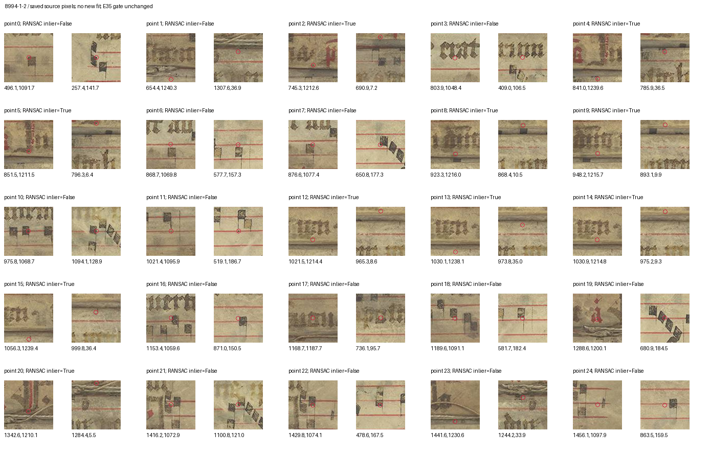
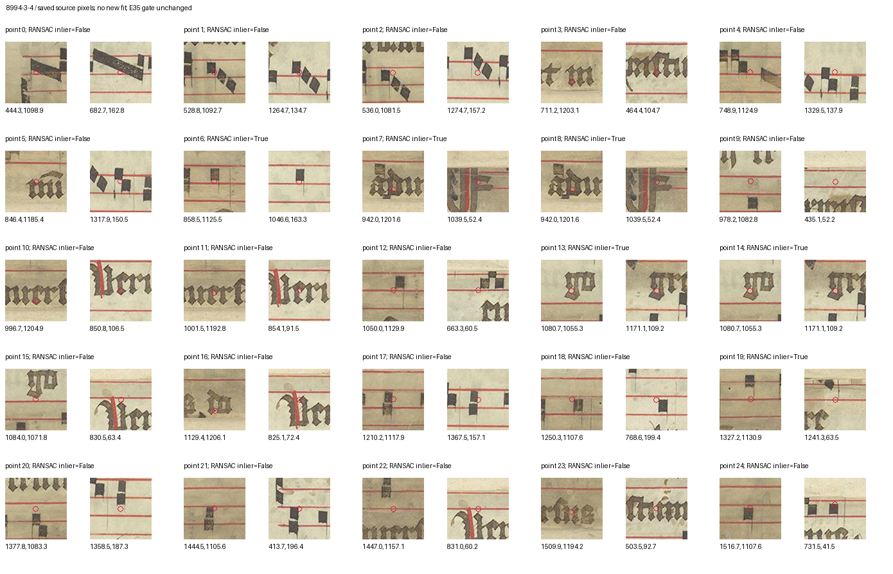

# E41: source-context audit of the photograph matches

28 October 2026, Europe/Vienna. E40 remains the latest new textual-placement clue. The interrupted intervening attempt produced no tested result and is recorded as no progress. This completed continuation tests the source detail behind E35's proposed photograph correspondences; it establishes no new manuscript relationship.

We manually inspected **all 25 stored mutual correspondences for each Fr8994 boundary**, six deterministically spaced matches from the known Fr20274 photographic overlap, and all seven stored inliers of the nonrepeat Fr8994 1/3 control. The 63 point pairs include repeated descriptor orientations and nearby positions. They are not 63 independent observations. The [protocol](research/continuation_41/protocol.json) discloses earlier image and feature-result exposure; this is a post hoc AI audit, with no blind or independent reviewer.

Each pair is shown in 96×96 original-pixel windows, clamped within the source image. There was no rotation, warping, rescaling, new feature extraction, fitting, ROI change or threshold adjustment. Exact coordinates, crop boxes, hashes and original inlier flags are in the [manifest](research/continuation_41/review_manifest.json); every manual judgment and reason is retained in [manual_review.json](research/continuation_41/manual_review.json).

| Selected comparison | Context judged distinctive and consistent | Generic similarity | Context mismatch | Insufficient context |
|---|---:|---:|---:|---:|
| Fr8994 1/2, all 25 mutual pairs | 0 | 11 | 2 | 12 |
| Fr8994 3/4, all 25 mutual pairs | 0 | 19 | 6 | 0 |
| Fr20274 known overlap, six selected pairs | 5 | 1 | 0 | 0 |
| Fr8994 1/3 nonrepeat, seven stored inliers | 0 | 7 | 0 | 0 |

These are descriptive manual categories for selected patches, not ground truth, classification accuracy or sensitivity estimates. A generic patch in the positive control does not invalidate its independently established photographic overlap.

The **ten 1/2 inliers** all lie at the narrow fold/frame-edge band: the right points are within 37 pixels of the top and the left points within 36 pixels of the bottom. Their 96-pixel windows contain little common vertical context. We retain E35's possible repeated folded-edge detail but do not identify a secure local match, complete surface, physical seam or medieval side. Insufficient context does not mean the fold matches have been disproved.



The **six 3/4 inliers occupy only four distinct positions**. Points 7/8 are two stored orientations pairing a small word with the other photograph's decorated initial/border. Points 13/14 repeat a small minim-cluster resemblance; the other inliers concern simple note or ruling motifs. The mismatched contexts explain why a numerical inlier is insufficient evidence of repeated photographed ink. They do not prove that the entire photographs show different surfaces.



Five of the six sampled positive-control pairs show matching multi-feature writing context. All seven nonrepeat-control inliers show generic motifs at just four distinct positions. The [positive](research/continuation_41/20274-overlap-positive-raw-patches.png) and [nonrepeat](research/continuation_41/8994-1-3-nonrepeat-raw-patches.png) sheets preserve the comparison. No result from the original six-pair numerical screen changed.

The useful outcome is narrower evidence: **the current feature matches cannot securely map Fr8994's complete surfaces**. This does not establish a novel exclusion or attribution. E40's possible terminal-text continuation still requires the designated Finnish original, a defensible Swedish surface/edge map, and its separate prior-art check. No missing source becomes a global research blocker.

The next local test is whole-capture text-row and boundary coverage, with deliberately mismatched photograph groupings as controls. A matching row total alone cannot establish a medieval side. E41 did not perform that optional test and does not report a new row count. Re-fitting the same features to force a pass would add no useful evidence.

Reproduce the figure selection, saved manual record and provenance check with:

```sh
.venv/bin/python research/continuation_41/make_review.py
.venv/bin/python research/continuation_41/record_review.py
.venv/bin/python research/continuation_41/check_sources.py
```

The record script encodes the disclosed manual judgments; rerunning it is not another visual review. The checker verifies coverage, coordinates/bounds, hashes and declared limits, not visual truth or novelty.

Knowledge version **1.5.1** enriches the existing E35 lead and its two unresolved imaging claims. It creates no new lead, historical claim or source region: totals remain **168 overlapping entries, 117 pair leads, 867 entities, 580 claims and 94 regions**. All frozen/core and E35 inputs remain byte-identical. No new downloads, manuscript files, outreach or publication occurred; the working inventory remains 179 files and the conservative transfer plan 1,666,761,179 bytes. The goal remains active, with no original discovery established.
