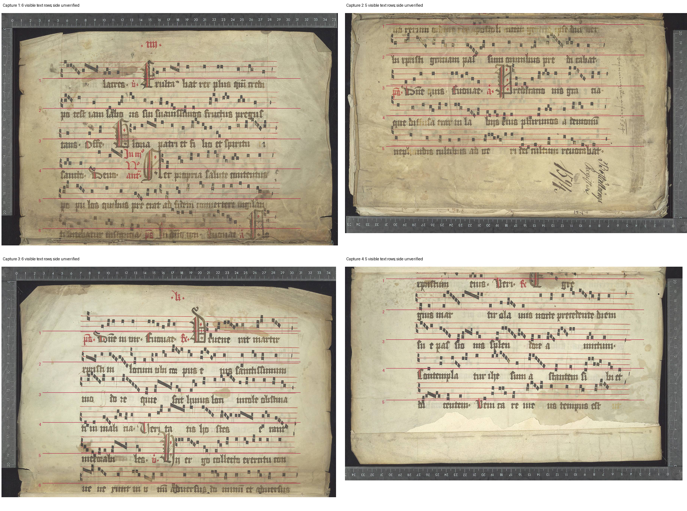
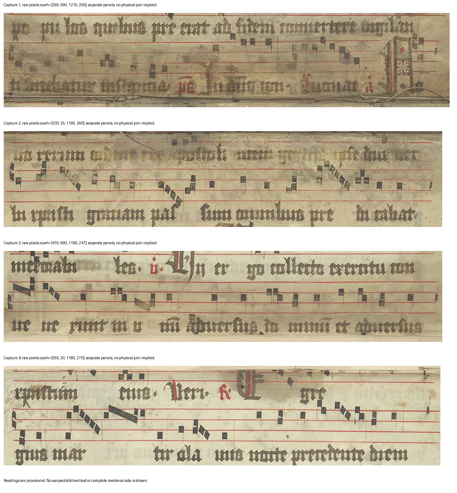

# E42: exact boundary text and a row-count control

28 October 2026, Europe/Vienna. The preceding E41 turn was progress: it recorded every selected raw-pixel match judgment and replayed the package. E42 completes its proposed local row/boundary test. This adds source observations and rules out row totals as a useful discriminator here; it does not identify a new codex or establish scholarly originality.

The [protocol](research/continuation_42/protocol.json) fixes all four retained Fr8994 photographs and four comparisons: proposed 1→2 and 3→4, plus deliberately mismatched 1→4 and 3→2. All images, prior chant-order work and E35/E40 results were already known. The new reading is exploratory AI work, not blind or independent confirmation. Original images and raw crops were inspected before reference lookup; later expansion assistance is declared in [sources.json](research/continuation_42/sources.json).

## Row count: the wrong pairings also fit

| Capture | Visible medieval text rows | Visibility limit |
|---|---:|---|
| 1 | 6 | Last row affected by fold shadow |
| 2 | 5 | First row faint at fold; upper music partly framed |
| 3 | 6 | Last row close to the photograph edge |
| 4 | 5 | First staff partly framed; text present |

All four predeclared pairings total **11**. That agrees numerically with the pinned catalogue's literal `#11` field, but cannot choose a pairing. The catalogue is an inherited assertion, not an independent count. Approximate row-body y-ranges, hashes, original URLs and counts are in [row_coverage.json](research/continuation_42/row_coverage.json). Modern wrapper notes were excluded. This counts text bands, not complete musical systems or chants.



No complete duplicated text row was demonstrated at the proposed boundaries. This prevents us from claiming a demonstrated repeated row or silently subtracting one from the total; it does not prove that obscured material contains no overlap.

## The words discriminate more than the count

The last two visible rows in captures1/3 and first two in captures2/4 were inspected. The [literal record](research/continuation_42/observations.json) retains uncertain letters, abbreviated christograms and gaps. It is not a complete diplomatic transcription; faint middle text remains unread rather than filled from a reference.

| Direction | Selected local text | Assessment |
|---|---|---|
| 1→2 | Decorated terminal `N[o?]` → `uo rerum […]` | Provisional split-word fit to *Novo rerum*. The small o remains uncertain. |
| 3→4 | `[…] et aduersus` → `xpistum eius` | Clearer local phrase fit, provisionally expanded *et adversus Christum eius*. |
| 1→4 | `N[o?]` → `xpistum eius` | Does not supply the proposed direct *Novo* word continuation. |
| 3→2 | `aduersus` → `uo rerum […]` | Does not supply the proposed direct verse continuation. |

The wrong groupings fail these particular direct textual bridges. That does not exclude gaps, nonadjacent readings, different surface arrangements or membership in one book. This is not a controlled population estimate of error or sensitivity.

There are also two within-photograph word-division checks: capture2's upper `uer-` is consistent with the next row's `bi`, and capture4's `Egre-` continues into `gius`. The latter reuses the already retained E40 region. These checks help interpret syllables across rows; they are not additional independent witnesses.



The [La Trobe University MMDB index](https://www.lib.latrobe.edu.au/MMDB/Genre/Antiphon.htm) already lists *Novo rerum ordine rex*. Only that index entry was successfully read; link-tool errors yielded no full record or underlying witness. The indexed [Vulgate Acts4:26 text](https://www.biblegateway.com/passage/?search=Actus+Apostolorum+4%3A26-28%2CActs+4%3A26-28&version=VULGATE%3BNIV), with its Psalm2 cross-reference, assisted identification of the second phrase. Direct page open returned Cache miss; it was not visually inspected. The modern reference and search-indexed text do not become another medieval chant witness or resolve our uncertain letters. No new chant ID, rare variant, melody or unique textual fingerprint is claimed. Exact read/access scope is retained in sources.json and the bibliography.

## Effect on the historical question

E34's proposed local reading order has more precise word/phrase support. The 1→2 split remains provisional; the 3→4 phrase fit is locally supported. **Complete medieval surfaces, recto/verso, immediate physical adjacency, photographed overlap and a physical join remain unestablished.** E35's fixed failed screens and E41's narrow fold judgment are unchanged. E40's Finnish terminal-text placement remains conditional on its original comparator, surface/edge map and unread prior art. A common verse cannot independently identify its book.

This completes the present row-count route: repeating the same sums or tuning the failed registration cannot promote the historical claim. The next action is to audit the complete bounded ten-case queue and limited pivot for remaining executable tests that could discriminate historical explanations, distinguishing them from repeated compatibility checks and claim-specific missing originals. This is an audit toward the full goal, not a claim that the discovery ambition is satisfied.

Reproduce the saved observations/figures and provenance/coverage check with:

```sh
.venv/bin/python research/continuation_42/record_evidence.py
.venv/bin/python research/continuation_42/check_sources.py
```

The script serializes retained manual readings/counts; replay is not a fresh independent reading. The checker verifies source hashes/dimensions, locators, all four comparisons, row-sum arithmetic and declared limits. It does not certify paleography, a complete surface map or novelty. Four new regions reuse the same four source photographs, with two earlier regions cited separately. No source image, catalogue input, frozen experiment, model or threshold changed. No new manuscript file/download was retained, and no outreach or publication occurred. The goal remains active; no original scientific discovery is established.
